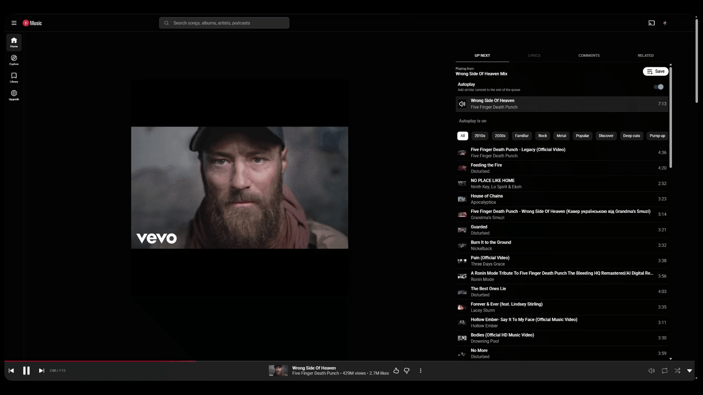
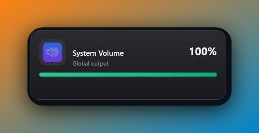
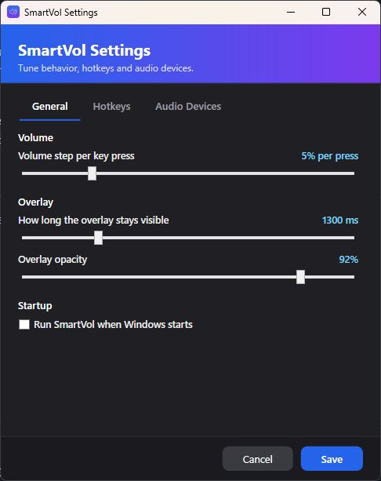
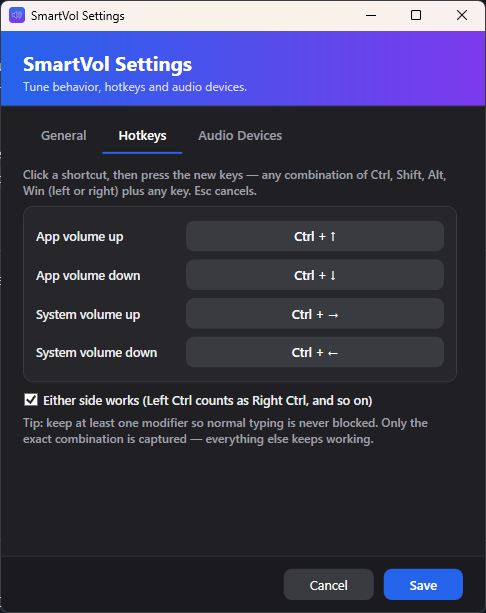
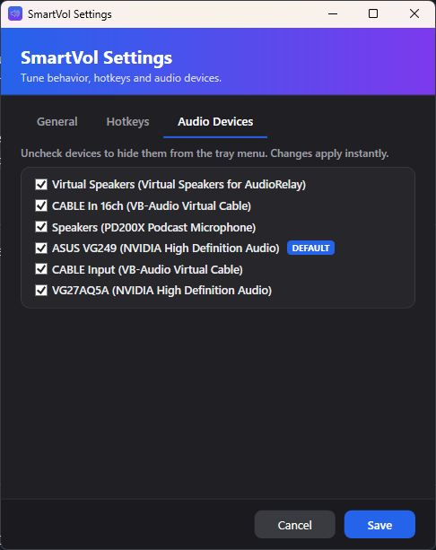

# SmartVol

Per-application and system volume control for Windows, with configurable
keyboard shortcuts, an on-screen overlay, and a system-tray menu.

## Features

- Adjust the focused app's audio-session volume or the system master volume.
- Show the app icon, window title, and current level in a non-focus-stealing
  overlay.
- Switch the default output device from the tray menu.
- Configure all four shortcuts, volume step, overlay appearance, startup
  behavior, and tray device visibility in Settings.
- Refresh available audio devices automatically when they change.

Default shortcuts:

| Keys | Action |
| ---- | ------ |
| Right Ctrl + ↑ | Raise the focused app's volume |
| Right Ctrl + ↓ | Lower the focused app's volume |
| Right Ctrl + → | Raise the system volume |
| Right Ctrl + ← | Lower the system volume |

Every shortcut can be customized from tray → Settings → Hotkeys. Either the
left or right modifier key can be enabled in Settings.

## Screenshots












## Download

Get the Windows x64 release from the
[GitHub Releases page](https://github.com/BishoyGit/SmartVol/releases/latest):

- **SmartVol.exe** — about 2 MB; requires the .NET 10 Windows Desktop Runtime.
- **SmartVol-portable.exe** — about 167 MiB; includes the runtime and needs no
  separate .NET installation.

Both downloads are single-file executables. The portable version is much
larger because it bundles the .NET runtime and WPF framework alongside the
application.

## Run and build

Requirements: Windows 10/11 and the .NET 10 SDK.

```powershell
# Run from source
dotnet run --project SmartVol

# Build
dotnet build SmartVol/SmartVol.csproj -c Release

# Publish both downloadable executables to publish/
.\publish.ps1
```

The small framework-dependent executable requires the .NET 10 Windows Desktop
Runtime on the target PC. The self-contained portable executable does not.
Trimming is disabled because the app uses WPF/XAML and WinForms `NotifyIcon`.

Useful flags: `SmartVol.exe --show-settings` opens Settings directly;
`SmartVol.exe --selftest-audio` runs a headless audio-pipeline check and exits.
Both write `smartvol.log` next to the executable.

## Settings

Settings are stored in `settings.json` next to the executable and mirrored to
`%APPDATA%\SmartVol\`. The Settings window includes:

- Volume step, overlay duration, and opacity.
- Startup behavior.
- The four hotkey combinations and optional either-side modifiers.
- Per-device tray-menu visibility.

Changes to volume, overlay, and device settings take effect immediately.

## Project layout

```text
SmartVol/
  App.xaml(.cs)               startup, single-instance guard, global logging
  VolumeController.cs         hotkey event -> audio + overlay glue
  TrayManager.cs               tray icon, device menu, settings/exit
  Services/                    audio, hotkeys, devices, config, logging
  UI/                          overlay and settings windows
  Assets/                      app resources
README.md
publish.ps1                    builds both release variants
```

## Icon attribution

The speaker glyph used in the app icon is from
[Flaticon](https://www.flaticon.com/free-icon/speaker_149139), used under its
free license with attribution. See [Assets/ATTRIBUTION.txt](Assets/ATTRIBUTION.txt).
